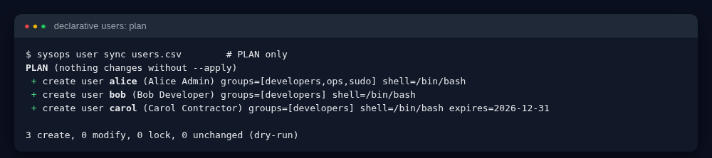
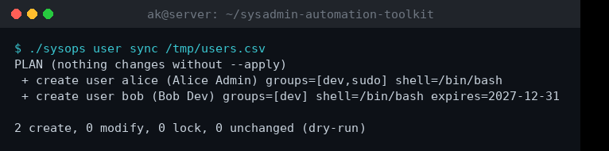
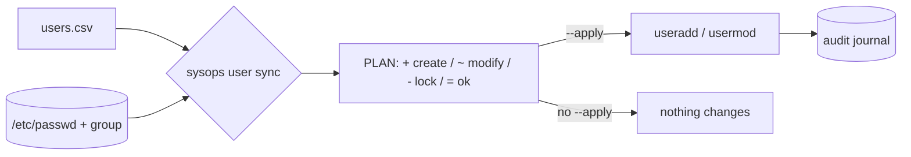
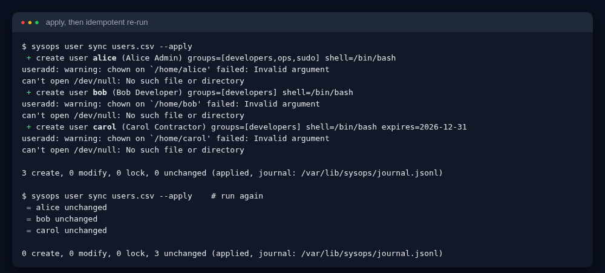
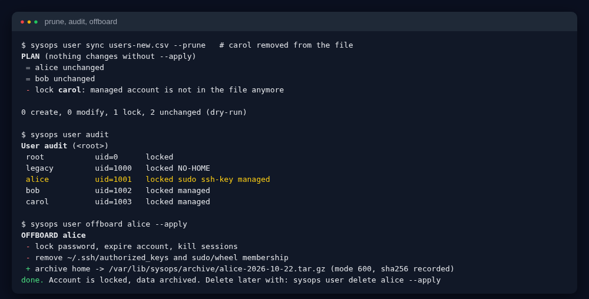
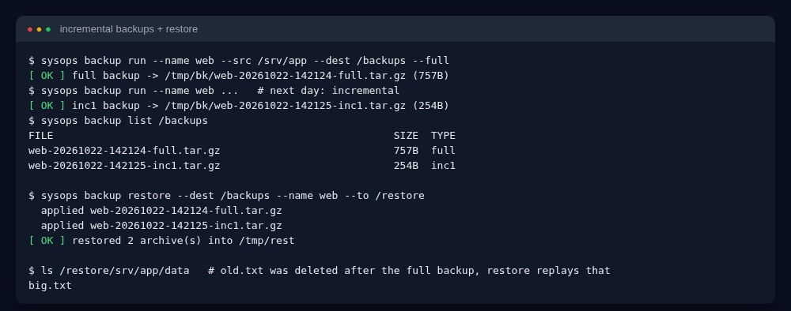
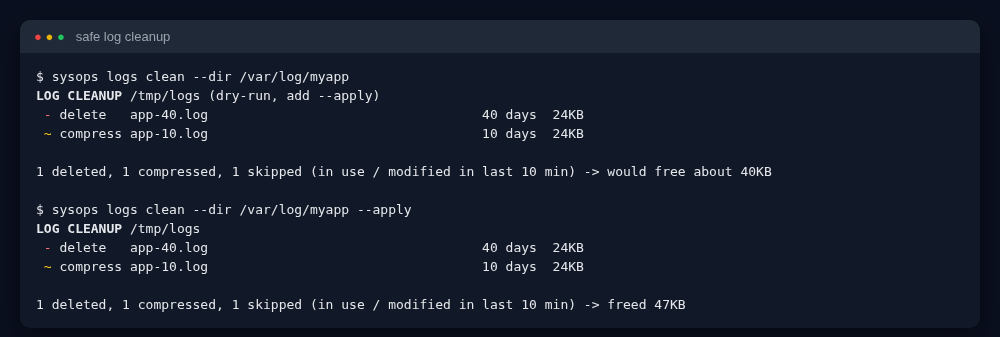
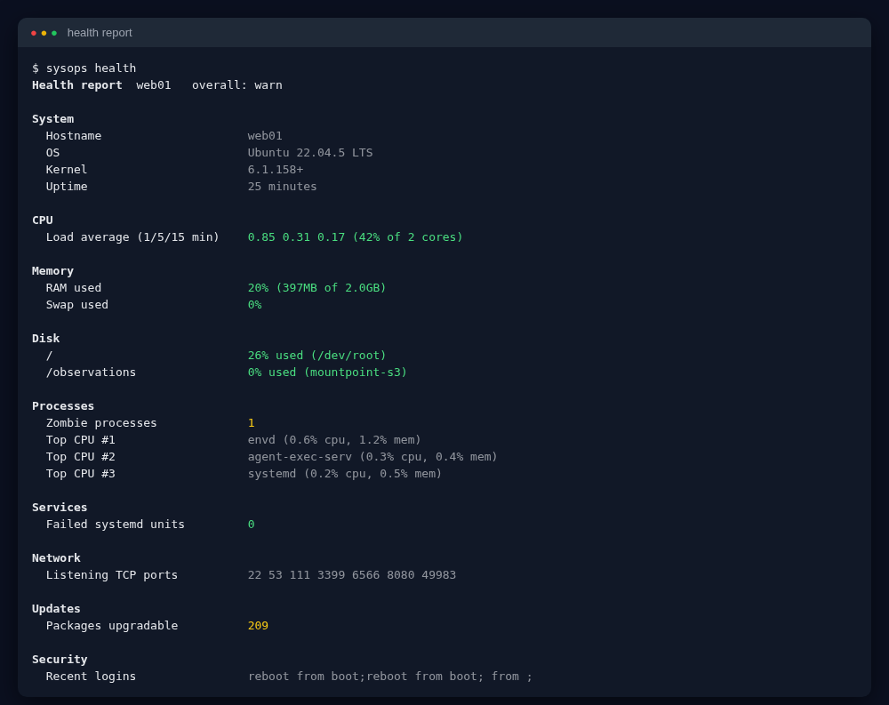
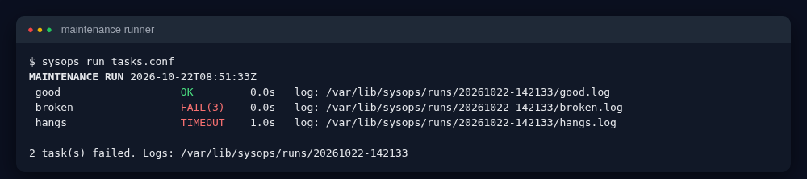

# Sysadmin Automation Toolkit (`sysops`)

[](https://github.com/AKASH991833/sysadmin-automation-toolkit/actions/workflows/ci.yml)
[](https://github.com/AKASH991833/sysadmin-automation-toolkit/releases)
  

The daily jobs of a Linux admin (create and remove users, take backups, clean logs, check health, run scheduled maintenance) as **one safe, tested command-line tool**. Pure Bash, no dependencies.

Every dangerous action is **a plan first** (dry-run by default), then `--apply`. Every applied action is written to an **audit journal**.



**20-second demo** (real output: plan, apply, idempotent second run, incremental backup):



## What makes this different

| Feature | Why it matters |
|---|---|
| **Declarative users (`user sync`)** | You write *what should exist* in a CSV. `sysops` compares it with the system and shows a plan: `+ create`, `~ modify`, `- lock`, `= unchanged`. Run it twice: the second run changes nothing (idempotent). Like Ansible's `user` module, in 300 lines of Bash. |
| **Only touches what it owns** | Accounts it creates carry a `[sysops]` tag. `--prune` locks only tagged accounts missing from the CSV. Pre-existing accounts (e.g. `legacy`) are never modified, and `delete` refuses untagged users. |
| **Offboarding in one command** | Lock, expire, kill sessions, remove SSH keys and sudo, archive the home with a SHA-256, keep the account record. Deleting is a separate step. |
| **Incremental backups that replay deletions** | Uses GNU tar snapshots (full + incrementals). Restoring rebuilds the latest state **including files deleted in between**. Checksums are verified before restore. Optional AES-256 encryption. Retention removes whole chains, never half of one. |
| **Safe log cleanup** | Compress after N days, delete after M days, skips files modified in the last 10 minutes or held open, refuses system directories, dry-run by default. |
| **Maintenance runner** | Runs a list of tasks with a **timeout per task**, an **overlap lock** (a slow run can never start twice), per-task log files, a summary table, exit code and optional webhook. |
| **Health report** | text / Markdown / HTML / JSON. Exit code 0 ok, 1 warning, 2 critical. |
| **Audit journal** | `journal.jsonl`: time, who (even through sudo), action, target, detail. |

> Preparing for an interview? Read [INTERVIEW.md](INTERVIEW.md) (60-second pitch, design choices, 10 Q&A).

## Quick start (60 seconds to your first plan)
```bash
git clone https://github.com/AKASH991833/sysadmin-automation-toolkit.git
cd sysadmin-automation-toolkit
./sysops health                                       # see your system
sudo ./sysops user sync examples/users.csv            # PLAN, nothing changes
sudo ./sysops user sync examples/users.csv --apply    # do it
sudo ./sysops user audit                              # who has sudo, no password expiry...
```

## Learn it from zero

### 1. Users, groups and why we manage them from a file
Every person or service needs an *account* (`/etc/passwd`), belongs to *groups* (`/etc/group`) and may have *sudo* rights (membership of the `sudo` group on Debian/Ubuntu, `wheel` on RHEL; `sysops` detects which). Doing this by hand with `useradd` on many servers causes mistakes and leftover accounts of people who left. A CSV is the single source of truth:

```csv
username,fullname,groups,shell,sudo,ssh_public_key,expires
alice,Alice Admin,developers;ops,/bin/bash,yes,ssh-ed25519 AAAA... alice@laptop,
carol,Carol Contractor,developers,/bin/bash,no,,2026-12-31
```
- `groups`: `;`-separated, created if missing.
- `sudo`: `yes` adds the admin group.
- `ssh_public_key`: installed in `~/.ssh/authorized_keys` (dir 700, file 600). Accounts have **no password**: key-only login is the secure default.
- `expires`: account expiry date (`useradd -e`), good for contractors.




**Prune, audit, offboard:**


`user audit` flags: `EMPTY-PASSWORD`, `sudo`, `ssh-key`, `pw-never-expires`, `NO-HOME`, `managed`.

### 2. Backups: full, incremental, restore
A **full** backup copies everything. An **incremental** copies only what changed since the last run, so it is fast and small. GNU `tar --listed-incremental` keeps a snapshot file (`NAME.snar`) to know what changed, and records deletions. A *chain* is one full + its incrementals; to restore you need the whole chain, which `sysops backup restore` does for you in order.
```bash
sysops backup run --name web --src "/etc /srv/app" --dest /backups --full      # Sunday
sysops backup run --name web --src "/etc /srv/app" --dest /backups             # other days (incremental)
sysops backup run --name web --src "/etc /srv/app" --dest /backups --key /root/backup.key   # AES-256 encrypted
sysops backup restore --dest /backups --name web --to /restore [--key /root/backup.key]
```
A failed run never damages the chain (the snapshot is updated only after tar succeeds). Keep the key file **outside** the backup disk. `--keep-chains N` prunes older chains as a unit.


### 3. Logs: why cleanup is dangerous and how it is made safe
Logs fill disks, but deleting a log that a service is still writing breaks the service or hides evidence. `logs clean` skips recent/open files, only compresses/deletes by *age*, shows the plan first, and refuses `/`, `/etc`, `/usr`, etc.


### 4. Health report
`sysops health [--format text|md|html|json]`: load vs cores, RAM/swap, every disk, zombies, top processes, failed systemd units, listening ports, pending updates, reboot-required, recent logins.


### 5. The maintenance runner and cron
`tasks.conf` (see `examples/tasks.conf`): `name | timeout | command`. `sysops run tasks.conf` runs them in order. A task that hangs is killed at its timeout (shows `TIMEOUT`); a second run started while the first is still busy exits with code 3 (`flock`). `sysops cron` prints a `/etc/cron.d` line.


### 6. Disk and journal
`sysops disk hogs /var 10` lists the largest directories and files. `sysops journal 20` shows the last audit entries (`$STATE/journal.jsonl`, default `/var/lib/sysops` as root).

### 7. Crontab management and LVM/RAID health
```
sysops cron add backup "30 2 * * *" "/usr/local/bin/backup.sh" --apply   # plan first, --apply writes; crontab is backed up
sysops cron list | status | validate | audit
sysops cron remove backup --apply
sysops cron wrap NAME --timeout 600 -- cmd args     # flock: a slow run never overlaps the next; failure -> webhook
sysops storage health            # RAID + LVM + fstab in one exit code
sysops raid status --alert       # parses /proc/mdstat: degraded, inactive, rebuilding
sysops lvm status --alert        # VG free space, snapshot/thin fullness (thresholds via env)
sysops lvm extend vg0/data --by 10G --apply      # refuses to eat the VG reserve, grows ext4/xfs online
sysops lvm snapshot create|list|remove|prune vg0/data
sysops lvm backup vg0/data --dest /backup        # snapshot -> read-only mount -> archive -> cleanup, plus vgcfgbackup
sysops fstab check                               # catches typos before the next boot does
```
Why: a bad `/etc/fstab` line stops a server from booting, a snapshot that fills up is silently invalidated, a degraded RAID is one disk away from data loss, and a cron job that outlives its interval runs twice. Each of these is checked, not assumed.

## Command reference
Run `./sysops` with no arguments for the full list. Environment: `SYSOPS_ROOT` (manage users of another root filesystem, for images and tests), `SYSOPS_STATE`, `SYSOPS_WEBHOOK_URL`, `NO_COLOR`.

## Honest test report
- `tests/run.sh`: **44 checks pass** locally. User tests run real `useradd/usermod/userdel` against a **fake root filesystem** (`-R`), inside a user namespace (no real root used): plan vs apply, idempotency, groups added and removed, SSH key permissions, expiry, prune/lock, untouched legacy account, offboard (lock + key + sudo removal + archive), delete guards. Backup tests compare the restored tree with the source (`diff -r`), replay of deletions, tamper detection, encryption, chain retention. Log, health (JSON/MD/HTML), runner (OK/FAIL/TIMEOUT, overlap lock) are covered.
- ShellCheck clean (`-S error`).
- **Not run in the author's sandbox:** operations on the *real* `/etc/passwd` (including killing sessions with `pkill`), and `apt` update counts. The `live` job in GitHub Actions runs real `useradd/userdel` on an Ubuntu VM; see the CI badge.
- **CI result (Oct 22, 2026):** `test` and `live` (real useradd/userdel on an Ubuntu VM) are green on the first run.
- **RHEL-family verified:** the `rhel-family` CI matrix runs the full suite, and `live-rhel-family` runs real useradd/offboard/delete asserting `sudo: yes` maps to the `wheel` group, on Rocky 9, AlmaLinux 9, CentOS Stream 9, Fedora (latest) and Red Hat UBI 9 (the free official Red Hat build - no RHEL subscription claimed).
- **Debian verified:** the `debian` CI matrix runs the full suite, and `live-debian` runs real useradd/offboard/delete asserting `sudo: yes` maps to the `sudo` group, on Debian 12 (bookworm) and Debian 13 (trixie).
- **v1.3.0 storage/cron:** fixture tests cover RAID/LVM parsing and thresholds, and real `crontab` tests run where cron is installed (CI sets `SYSOPS_REQUIRE_CRON=1`, so a missing cron fails instead of skipping). `tests/storage-live.sh` really does it, as root, on loop devices: online ext4 grow, snapshot overflow, prune, snapshot backup + restore with checksums, VG nearly full, and RAID1 fail/degrade/remove/add/rebuild. See the per-distro table below.
- Password-based accounts are intentionally not created (key-only).

| v1.3.0 | cron tests | fixture storage tests | real LVM extend + RAID | real snapshot + backup drills |
|---|---|---|---|---|
| Ubuntu runner (31 checks pass) | real crontab | yes | yes | yes |
| Debian 12 (container, 31 checks pass) | real crontab | yes | yes | yes (host kernel modules mounted) |
| Debian 13, Rocky 9, Alma 9, CentOS Stream 9, Fedora (containers) | real crontab | yes | **RAID real (9 checks); real LVM skipped** - device-mapper is not usable in these containers (the drill probes and prints a NOTE) | skipped |
| UBI 9 | real crontab | yes | no (no mdadm/lvm2) | no |
Containers share the runner kernel; this table is updated from the CI results, not from hope.


## License
MIT


## Enterprise v2 learning modules

Start at [LEARN.md](LEARN.md). Native builds and installation instructions: [packaging/LEARN.md](packaging/LEARN.md).

The shared enterprise hub is [linux-server-hardening-monitoring](https://github.com/AKASH991833/linux-server-hardening-monitoring):
- `compliance/`: all 50 hk checks accounted for, with 10 verified related/partial mappings to the actual CIS Ubuntu 22.04 LTS v2.0.0 PDF; the rest are explicitly unmapped. No CIS certification and no claim that Ubuntu IDs apply to Debian/RHEL.
- `ansible/`: selected plan-first hk hardening, rolling multi-host playbook, rootfs and live-VM idempotence tests. Not full CIS or webstack deployment.
- `monitoring/`: non-root read-only exporter, Prometheus rules with firing/recovery tests, provisioned Grafana dashboard, localhost-only Compose demo. Container metrics are not full host metrics. No notification receiver is configured.
- `incidents/`: harmless filesystem/log simulation with generated timeline and evidence, detection, containment, rollback and eradication. This is not a real exploit or production incident.

Each repository has .deb/.rpm build/install/remove CI. The Pages publication workflow builds signed APT/RPM metadata and tests installs through the repository before deployment. Keys rotate each publication and expire in 30 days; RPM package headers are unsigned. This is a learning channel, not unattended production updates. See packaging/LEARN.md before trusting/installing anything.

Tests distinguish fixtures from real services and kernel work. v1.3 storage limits still apply: real LVM is verified only on the Ubuntu runner and Debian 12, not every container. A green package install does not verify every workload command. CI artifacts hold generated incident reports and Grafana screenshots.
